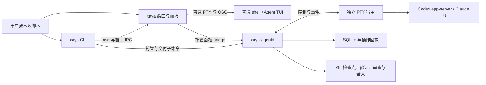
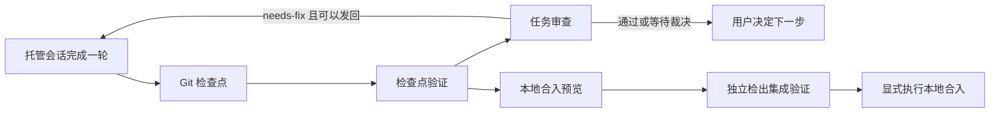

# XaYa 功能与技术现状

**整理日期** 2026-11-19
**产品定位** 面向 Apple Silicon macOS 的终端与 AI 编码工作台，当前版本为 `0.0.1`。应用为 `XaYa.app`，命令为 `xaya`。

XaYa 保留 Alacritty 的终端能力，并在应用内提供 Agent 状态感知和并行开发工具。托管服务进一步提供 Codex、Claude 的生命周期管理，以及从 Git 检查点、验证、审查到本地合入的持久化流程。

## 1. 已有功能

| 能力 | 已实现 | 入口 |
|---|---|---|
| 终端 | VT 仿真、滚动历史、选择、搜索、vi 模式、URL 与文件位置跳转。macOS 默认 Metal，支持回退 OpenGL。 | 应用窗口、配置文件 |
| 并行工作 | 窗口、标签、分屏、焦点切换、独立 Git worktree 标签、检测多个 Agent 共用同一检出。 | `Cmd+D`、`Cmd+Shift+D`、`Cmd+Shift+T` |
| Agent 感知 | 识别工作、等待、完成和失败，显示进度和等待时长。提供标题徽标、注意力跳转、面板、macOS 通知和 Dock 徽标。 | `Cmd+Shift+A`、`Cmd+J`、`xaya msg status` |
| Shell 与编辑器 | zsh、bash、fish 提示符标记，提示符间跳转、长命令通知、读取上一条命令输出。文件路径可交给编辑器并定位行列。 | Shell 集成脚本、`xaya msg get-text`、文件链接 |
| 每轮改动 | 按 Agent 轮次边界捕获 Git 前后快照，查看文件与行数统计和 diff。 | 普通 Agent 面板、IPC |
| 窗口恢复 | 记录工作目录、识别原生会话并尝试恢复。已识别的托管 Codex 走托管目录。 | 应用启动、会话配置 |
| 托管会话 | 启动、脱离、重连、停止、显式恢复、崩溃后接管、程序发送、指定轮次中断、审批、条件式工具进程清理。 | `xaya run`、`xaya attach`、`xaya agent session` |
| 托管面板 | 服务推送看板，查看会话、审批、最新验证和审查，操作中断、工具清理和发回修复。 | 面板按 `m`，详情按 `a`、`v`、`r` |
| Git 检查点与验证 | 私有提交、显式命令验证、多步骤项目计划、日志及回执、验证读取检查点的绑定证明。 | `xaya checkpoint`、`xaya project`、`xaya check` |
| 任务与审查 | 固定验收条件、确定性交接包、单引擎或双引擎审查、发现台账、用量记录、修复预算和熔断。 | `xaya task`、`xaya review` |
| 前台修复循环 | 串行驱动检查点、项目验证、审查和发回。通过回执中的轮次 ID 确认实现完成后再复查。 | `xaya task cycle` |
| 本地合入 | 生成 squash 候选、在独立检出复验、更新本地目标分支，以及中断后的结果核对与显式续合。 | `xaya land preview`、`verify`、`run`、`reconcile`、`resume` |

终端使用方法见[用户手册](user-guide.zh-CN.md)，渲染实现见 [Metal 渲染器](metal.md)。

## 2. 运行架构

| 模块 | 主要职责 |
|---|---|
| [`alacritty_terminal`](../alacritty_terminal/src/lib.rs) | 终端网格、PTY、VT 解析、OSC 消息和 Shell 标记 |
| [`alacritty`](../alacritty/src/main.rs) | `xaya` 入口、窗口和 pane、输入与渲染、应用 IPC、普通面板和托管面板 |
| [`alacritty_config`](../alacritty_config/src/lib.rs) / [`alacritty_config_derive`](../alacritty_config_derive/src/lib.rs) | 配置反序列化与派生宏 |
| [`xaya_agent_proto`](../xaya_agent_proto/src/lib.rs) | 托管服务 JSON-RPC 消息和领域类型 |
| [`xaya_agentd`](../xaya_agentd/src/lib.rs) | 独立服务、引擎适配与宿主、事件、持久化及交付操作 |

普通终端的 Agent 感知来自 PTY 中的 OSC 7501；Shell 集成使用 OSC 133。应用用窗口 IPC 暴露终端状态和操作，并通过独立 companion CLI 读写托管服务。服务的本地 Unix socket 和数据库使用私有文件权限；会话、控制回执与交付记录落盘后再派发相应操作。SQLite 主库采用 WAL 和 FULL 同步，事件历史使用独立的 NORMAL 同步连接。事件订阅可按 epoch 和序号续传已落盘事件；完整原生对话由引擎保存。

主要代码入口：[OSC 状态](../alacritty_terminal/src/program_status.rs)、[每轮改动](../alacritty/src/turn_changes.rs)、[窗口 IPC](../alacritty/src/polling/ipc.rs)、[托管面板桥](../alacritty/src/managed_panel/bridge.rs)、[服务路由](../xaya_agentd/src/server.rs)、[持久化](../xaya_agentd/src/storage.rs)。

## 3. 普通会话与托管会话

| 维度 | 普通终端会话 | 托管会话 |
|---|---|---|
| 启动 | 在 shell 里直接执行 `codex` 或 `claude` | `xaya run`，可用 `--detach` 仅启动后端 |
| 状态来源 | 工具上报的 OSC 7501，辅以前台进程和 Shell 标记 | 引擎原生协议或 Mods 事件，由服务维护会话与轮次 |
| 控制 | 用户在原生 TUI 操作 | 原生 TUI、托管面板、服务 CLI |
| 恢复 | 窗口快照与原生会话发现 | 固定内部会话 ID 和原生 ID，独立宿主支持重新 attach 和服务重启后接管 |
| Git 交付 | 普通面板可看轮次 diff | 可绑定检查点、验证、审查、任务和本地合入回执 |

**Codex** 的 app-server 运行在独立宿主中，服务转发原生 TUI 连接并绑定主 thread。默认以只读权限启动，可显式选择工作区写入。兼容的 Codex TUI 可由 `xaya attach` 拉起崩溃后的服务并重连同一后端。正在等待的审批可由 Codex 在 resume 后重新发出。[Codex 托管说明](managed-codex.zh-CN.md)

**Claude** 的交互式 TUI 运行在 XaYa 自有 PTY 中，Mods 上报身份、轮次和工具状态并执行输入门禁。服务重启后通过快照重新接管。检查点、验证或合入前必须确认同一检出中的托管 Claude 进程已结束；自动循环只会停止空闲且未 attach 的实现会话。工具审批的并发同名请求和子 Agent 请求留在原生 TUI。[Claude 托管说明](managed-claude.zh-CN.md)

正常停止服务会结束托管后端。服务崩溃后，如果宿主仍存活且身份可证明，重启会接管原进程；无法确认归属时保留 `interrupted`。未确认的控制命令记为 `unknown`，由用户查询回执后决定下一步。已停止的会话通过 `attach` 或 `session resume` 显式恢复。[崩溃和事件说明](managed-sessions.zh-CN.md)

## 4. 交付链路与状态

### 检查点与验证

- `checkpoint create` 捕获整个 Git 检出的工作文件，包括未忽略的未跟踪文件。临时 index 和 `refs/xaya/checkpoints/<id>` 保留快照，用户的 HEAD、分支和暂存区保持原状态。
- `check run` 验证显式命令；`check project` 执行 `.xaya/project.toml` 中已信任的具名步骤。信任绑定规范化检出根目录与原始配置哈希。这两类验证使用原检出和现有依赖，运行前后检查 HEAD 和 tree 是否仍匹配。
- `check bind` 在私有检出中对比干净树和受控变更后的验证结果，为检查是否读取绑定源码提供证据。项目可以用 `require_binding` 把通过的绑定证明设为合入条件。
- 回执关联检查点、commit、tree、结果和日志。后续查询会重新判断相关状态是否过期。 [检查点与验证说明](managed-sessions.zh-CN.md#检查点)

### 任务与审查

- `task new` / `task promote` 记录目标、约束和固定验收条件。服务生成绑定检查点的交接包，包含改动路径和对象 ID，供审查者独立评估。
- `review run` 在私有检出调用只读审查者。服务核对发现是否落在改动范围内，并综合验证结果、阻塞发现、验收条件和审查者结论，产出 `approved`、`needs-fix`、`blocked` 或 `invalid`。批准要求绑定的验证通过。
- `--dual-review` 是任务级策略。Codex 和 Claude 在依次重建的私有检出中审查同一个检查点，共用超时。两者都批准才通过；发现取并集，重复项保留更严重的结果，验收条件取更保守的结论。单引擎和双引擎回执均可保存原生会话 ID 及引擎返回的输入、输出和缓存计数。
- `review send` 可把有效的 `needs-fix` 审查发回一次。任务台账记录发现首次出现、消失、重现和驳回。驳回会影响发回与熔断判断，原审查结论保留。
- 默认修复预算为 2 轮。连续两次无效审查、发回后 Git tree 未变、未驳回的阻塞发现再次出现，都会要求人工关注。`task continue` 可继续任务并追加轮次。 [任务说明](managed-sessions.zh-CN.md#任务与交接包xaya-task)

### 自动循环与本地合入

- `task cycle` 是显式启动的前台命令，使用可信项目计划。只有有效的 `needs-fix` 会发回。循环等待对应实现轮次的完成事件，遇到验证失败、预算用尽、熔断、等待输入或无法确认时停止。用户通过 `task close` 结算任务。
- `land preview` 以检查点和验证记录构造候选，`land verify` 在独立检出重跑验证，`land run` 复核源、目标和回执后执行本地快进。未检出目标通过引用比较交换更新；已检出目标通过受锁的工作区和 index 更新。中断后可显式核对或从可证明的状态续合。
- 本地合入的自动门禁检查验证、候选和目标版本，审查结论由用户在发起合入时参考。`task cycle` 到审查通过即结束；本地合入由用户显式执行。 [循环说明](managed-sessions.zh-CN.md#驱动修复循环xaya-task-cycle) · [合入说明](managed-sessions.zh-CN.md#安全合入预览与复核)

## 5. 当前边界与验收

| 范围 | 当前边界 |
|---|---|
| 平台与可见性 | 正式体验与真实窗口验收聚焦 Apple Silicon macOS。普通 Agent 的状态取决于引擎是否上报协议，普通模式的直接审批仍是协议提案。 |
| Pane 与检出 | 分屏会话恢复为多个标签。轮次 diff 统计同一检出在窗口期内的变更，可能包含其他进程的写入。精确 pane 身份绑定和自动 worktree 分配仍待实现。现有 worktree 入口由用户主动触发。 |
| 托管与掉线 | 托管面板支持结构化操作，自由输入在原生 TUI 或 CLI 完成。连接断线后的恢复取决于宿主、引擎和事件历史是否仍可用。`end-tools` 依赖工具归属标记，并要求轮次已经结束。 |
| 工作区与验证 | 门禁覆盖 XaYa 管理的输入及进程。外部编辑器、其他 Git 客户端和非托管进程仍可能修改检出。验证命令按用户授权在本机运行。特殊 Git 布局与索引有明确拒绝条件。 |
| 审查与修复 | 当前已有发现过滤、合并、台账和驳回。独立的发现复核阶段尚未实现。审查通过绑定的是指定检查点，真实模型结果质量需单独评估。 |
| 交付边界 | 本地合入以集成验证为依据，远程 push、源分支删除和发布由外部流程负责。 |

在整理时的验收中，工作区 Rust 测试 **648 项通过、2 项 GPU 测试默认忽略**，Clippy 与格式检查通过。真实 macOS 面板通过 38 项检查；真实 Codex、Claude CLI 用本地模型验收了双审查者和用量记录。

## 6. 继续阅读

- [终端架构细节](architecture.zh-CN.md)（其中托管章节有早期实现描述，当前托管能力以本页和各引擎说明为准。）
- [托管会话、验证、审查与合入参考](managed-sessions.zh-CN.md)
- [用户使用说明](usage-manual.zh-CN.md)
