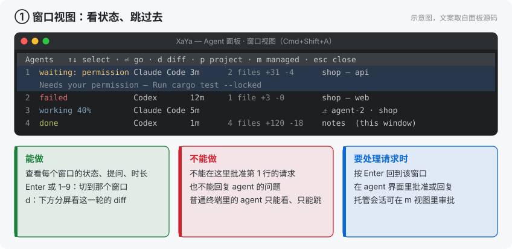
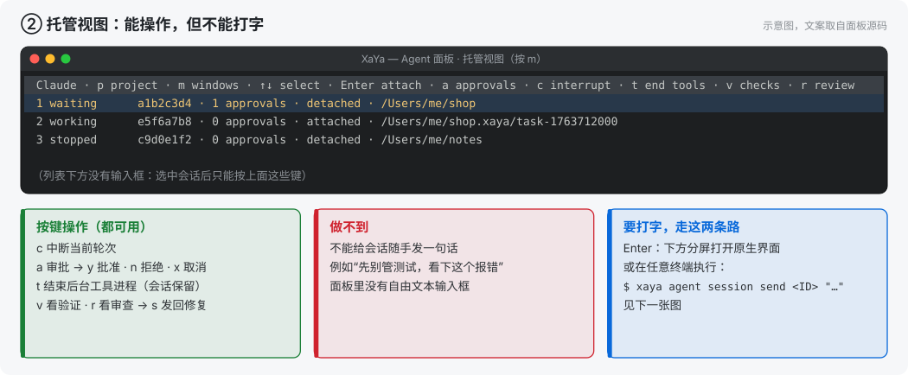
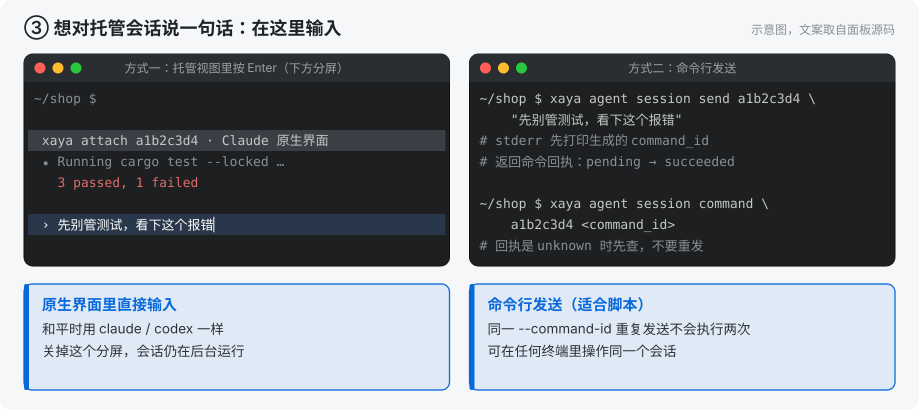
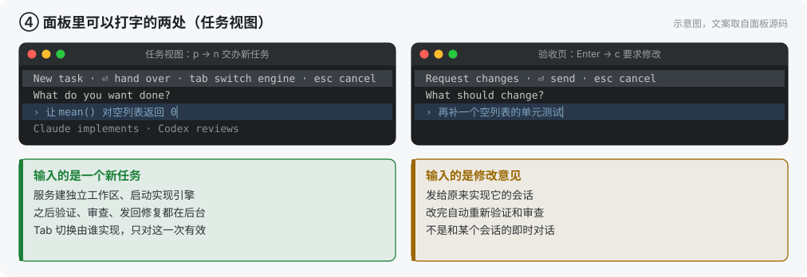

# XaYa 用户使用说明（功能完整度与上手指南）

> 整理日期：2026-11-24 · 版本 0.0.1
>
> 本文回答两个问题：**XaYa 现在能做什么、做到什么程度**，以及**现在应该怎么用它**。
> 细节参考文档见文末“文档索引”。

---

## 1. XaYa 是什么

XaYa 是 fork 自 Alacritty 的 macOS 终端（Apple Silicon，macOS 11+），面向“同时跑多个 Claude Code / Codex”的开发者。它分三层，可以只用第一层，也可以一路用到第三层：

| 层级 | 你得到什么 | 入口 |
|---|---|---|
| ① 增强终端 | Metal 渲染终端 + 看得懂 agent 状态（徽标、通知、Dock、面板、跳转）+ 分屏 / worktree / 会话恢复 | 打开 XaYa，照常运行 `claude`、`codex` |
| ② 托管会话 | 由后台服务 `xaya-agentd` 托管的 Codex/Claude 会话：关掉 TUI 继续跑、可重连、服务崩溃可接管、可从面板/CLI 审批、中断、发送 | `xaya run`、`xaya attach`、`xaya agent session …` |
| ③ 任务流水线 | 一句话交办 → 独立工作区实现 → 检查点 → 项目验证 → 另一引擎审查 → 自动发回修复 → 你验收 → 本地合入 → 清理工作区 | Agent 面板 `p` → `n`，或 `xaya task delegate` |

---

## 2. 功能完整度总览

成熟度标记：**稳定** = 日常可用、经真实窗口/真实 CLI 验收；**可用** = 功能完整、自动化测试覆盖，但真实环境验收较少；**实验** = 能用但边界较多、接口可能变化。

| 模块 | 成熟度 | 现状 | 主要边界 |
|---|---|---|---|
| 终端本体（VT、滚动、搜索、vi 模式、hints、Metal/OpenGL） | 稳定 | 继承 Alacritty，macOS 默认 Metal，不可用时回退 OpenGL | 优化与验证只针对 macOS |
| Agent 状态感知（标题徽标 ⏳🔔✅❌、通知、Dock 计数、`Cmd+J`） | 稳定 | 基于 OSC 7501，Claude Code ≥ v2.1.295、Codex ≥ rust-v0.163.0 自动上报 | 普通终端里的 agent 不能从通知/面板直接审批（仅提案） |
| Agent 面板（窗口视图） | 稳定 | 列出所有窗口状态、消息、时长、上一轮改动，`d` 看 diff | 轮次 diff 会算入同一检出里其他进程的改动 |
| Shell 集成（zsh/bash/fish，OSC 133） | 稳定 | 提示符跳转、长命令通知、读取上一条命令输出 | 需手动在 rc 文件里 source |
| 文件位置跳转（`Cmd`+单击、`Ctrl+Shift+E`） | 稳定 | 识别 `path:line:col`，可配置编辑器定位行列 | — |
| 分屏 | 稳定 | 右/下分屏、焦点切换 | 只能平分，不能拖动调整大小或放大 |
| Worktree 标签（`Cmd+Shift+T`） | 稳定 | 一键新建 worktree + 新标签 + 启动同一 agent；共用检出时提醒 | 不自动清理，需 `git worktree remove` |
| 会话恢复 | 稳定 | 重启后恢复 agent 窗口并 `--resume` | 分屏恢复为多个标签；Codex 同目录多会话时让你选 |
| `xaya msg` 命令行控制 | 稳定 | status/focus/get-text/send-text/split/create-worktree | `send-text` 默认关闭 |
| 托管会话：Codex | 可用（实验性标注） | 后台宿主持有 app-server，关 TUI 不停、服务崩溃轮次不断、可 attach/resume | 默认只读沙箱，写入需 `--sandbox workspace-write` |
| 托管会话：Claude | 可用（实验性标注） | 自有 PTY 宿主 + Mods 上报，崩溃后接管、显式 resume、程序发送、面板审批 | 并发同名审批、子 agent 审批仍需在原生 TUI 处理；checkpoint 前需停止会话 |
| 托管面板（面板内按 `m`） | 可用 | 服务推送看板；中断 `c`、审批 `a`/`y`/`n`/`x`、结束工具 `t`、验证 `v`、审查 `r`/`s` | 面板内不能自由输入文本（请用 TUI 或 CLI） |
| 检查点 / 验证 / 绑定证明 | 可用 | 私有 Git 引用快照；单命令或 `.xaya/project.toml` 多步骤验证；`check bind` 证明 | 不支持 submodule、sparse checkout 等特殊布局；无检查点删除接口 |
| 审查（单/双引擎） | 可用 | 私有只读检出审查，服务按固定规则判 approved/needs-fix/blocked/invalid，记录用量 | 没有独立的“发现复核”阶段；模型质量需自行评估 |
| 任务、发回修复、预算、熔断、驳回 | 可用 | 验收条件逐条判定、发现台账、默认 2 轮修复预算、三种熔断、`dispute` | 验收条件创建后不可改 |
| 前台循环 `task cycle` / 后台驱动 `task drive` | 可用 | 自动走 检查点→验证→审查→发回，后台版本跨服务重启续跑，审查失败有退避重试 | — |
| 任务队列、项目容量、依赖、任务工作区 | 可用 | `enqueue`、容量 1–16、`--depends-on`、服务自建 `<仓库>.xaya/<任务ID>` 工作区 | 队列只负责启动首轮 |
| 一步交办 `task delegate` + 面板交办 | 可用（最新） | 一句话创建任务并全程后台驱动到审查通过；面板 `p`→`n` | 只能给一条验收条件；多条件/约束/依赖要分步命令 |
| 验收页 / 后台合入 / 要求修改 / 工作区清理 | 可用（最新） | 面板验收页看 diff、按 `l` 合入、`c` 要求修改；合入后自动删工作区 | 只合入本地分支，**不 push**；合入授权不可撤销；手动 `land run` 或放弃的任务不清理工作区 |
| 项目默认实现引擎 `task engine` | 可用（最新） | 按仓库保存默认 Claude/Codex | 面板内不能改默认（用 CLI）；不自动探测本机有哪个引擎 |

**测试现状**（据开发验收记录）：全量 Rust 测试 738 项通过、2 项 GPU 测试默认忽略，Clippy 零警告；托管面板曾在真实 macOS 窗口通过 38 项检查；双审查和用量用真实 Codex/Claude CLI 验收过。最近几批（交办、验收、合入、引擎切换）只做了自动化测试，**尚未做 GUI 端到端和真实引擎验收**，使用时建议多看一眼结果。

---

## 3. 安装与首次设置

### 3.1 构建安装

```sh
brew install scdoc                 # 生成 man 手册需要
make app                           # 需要 Rust ≥ 1.88、Xcode Command Line Tools
cp -R target/release/osx/XaYa.app /Applications/
```

`XaYa.app` 内同时包含 `xaya` 和托管服务 `xaya-agentd`。想在任意终端里使用 `xaya` 命令，把它加入 PATH，例如：

```sh
ln -sf /Applications/XaYa.app/Contents/MacOS/xaya /usr/local/bin/xaya
```

### 3.2 Shell 集成（强烈建议）

在 rc 文件**末尾**加一行：

| Shell | 文件 | 内容 |
|---|---|---|
| zsh | `~/.zshrc` | `source /Applications/XaYa.app/Contents/Resources/shell-integration/xaya.zsh` |
| bash | `~/.bashrc` | `source /Applications/XaYa.app/Contents/Resources/shell-integration/xaya.bash` |
| fish | `~/.config/fish/config.fish` | `source /Applications/XaYa.app/Contents/Resources/shell-integration/xaya.fish` |

### 3.3 配置文件（可选）

XaYa 不自动创建配置，按顺序取第一个存在的：`$XDG_CONFIG_HOME/xaya/xaya.toml` → `~/.config/xaya/xaya.toml` → 旧 Alacritty 配置。

```sh
mkdir -p ~/.config/xaya
cp xaya.example.toml ~/.config/xaya/xaya.toml   # 全部配置项及中文说明，原样复制不改变行为
```

修改后自动生效。常改的几项：

```toml
[notifications]
only_when_unfocused = true      # 只在窗口不在前台时通知
command_threshold = 10          # 普通命令超过 N 秒完成时通知（需 shell 集成）

[hints]
editor = { program = "code", args = ["-g"] }   # Cmd+单击跳到具体行列

[session]
restore = "Agents"              # "Agents" | "All" | "Never"
```

### 3.4 macOS 系统设置

- 系统设置 → 通知 → XaYa：允许通知，并打开“标记”（Dock 数字）。

### 3.5 使用任务流水线前的一次性准备（仅层级 ③ 需要）

1. 本机装好 `claude` 和 `codex` 并已登录（从访达启动 XaYa 时，面板会读取登录 shell 的 `PATH` 找它们）。
2. 在仓库根目录写验证计划 `.xaya/project.toml`：

   ```toml
   [verify]
   timeout = "20m"
   steps = [
     { name = "build", argv = ["cargo", "build", "--locked"], timeout_secs = 600 },
     { name = "test",  argv = ["cargo", "test", "--locked"] },
   ]
   ```

   命令直接执行 argv，不经 shell；需要 shell 时写 `["sh", "-c", "…"]`。目前只支持 `[verify]` 段，步骤 1–16 个。
3. 查看并信任这份计划（信任绑定文件哈希，改了文件要重新信任）：

   ```sh
   xaya project show -C .                       # 输出 config_hash
   xaya project trust -C . --hash <config_hash>
   ```
4. 可选：设置项目默认实现引擎、并发上限：

   ```sh
   xaya task engine . --set codex     # 默认是 Claude；--reset 恢复
   xaya task capacity . --limit 2     # 默认 1，可设 1–16
   ```

---

## 4. 层级 ①：把 XaYa 当作 agent 终端

**日常流程**

1. 打开 XaYa，运行 `claude` 或 `codex`，无需额外设置。
2. 让 agent 干活，去做别的事。它需要你时：通知弹出、标题出现 🔔、Dock 显示等待数。
3. `Cmd+J` 跳到最需要你的窗口（等待 > 失败 > 完成，同级等得最久的优先）；`Cmd+Shift+A` 打开面板看全局。
4. 想再开一个 agent 又不想改同一份代码：`Cmd+Shift+T`，在新 worktree（`<仓库>.worktrees/agent-N`）里开标签并启动同一 agent。
5. 想让 agent 和 shell 并排：`Cmd+D` / `Cmd+Shift+D`。
6. 退出或重启 XaYa 后，运行 agent 的窗口会自动回来并续接会话。

**面板（窗口视图）按键**

| 按键 | 作用 |
|---|---|
| `↑↓` / `j k` / `Tab` | 选择 |
| `Enter` / `1`–`9` | 切到该窗口 |
| `d` | 下方开 pane 显示该窗口上一轮改动的 diff |
| `m` | 切到托管会话视图（层级 ②） |
| `p` | 切到当前仓库的任务视图（层级 ③） |
| `Esc` / `q` / `Cmd+Shift+A` | 关闭 |

**常用脚本化命令**

```sh
xaya msg status                          # 所有窗口状态表
xaya msg status --wait && say done       # 全部 agent 完成后提醒
xaya msg status --watch --json           # 持续输出状态变化
xaya msg get-text --last-command         # 上一条命令及输出（需 shell 集成）
xaya msg split -c codex                  # 旁边分屏开一个 codex
xaya msg create-worktree -b fix-x -c claude
```

`xaya msg send-text` 需在配置中显式开启 `[general] ipc_send_text = true`（开启后本机任何程序都能给 agent 下指令）。

---

## 5. 层级 ②：托管会话

适合：希望关掉终端 agent 也继续跑、想在别的终端/脚本里观察与控制、要用检查点和审查。

```sh
xaya run "阅读项目并说明主要模块"                     # Codex，默认只读
xaya run --sandbox workspace-write "修复失败的测试"    # Codex 允许写工作区
xaya run --engine claude "解释这个项目"                # Claude
xaya run --detach "…"                                  # 只启动后端，打印内部会话 ID

xaya agent session list                                # 列出会话
xaya attach <会话ID>                                   # 关掉 TUI 后重新接上；已停止的会话会显式恢复
xaya agent session stop <会话ID>
```

**观察与控制（另一个终端里）**

```sh
xaya agent session watch <ID>                 # 快照 + 实时 JSON 事件；--after EPOCH:SEQ 断点续传
xaya agent session history <ID>               # 已落盘事件
xaya agent session send <ID> "继续处理测试失败"
xaya agent session cancel <ID>                # 中断当前轮次
xaya agent session approvals <ID>             # 待审批请求
xaya agent session respond <ID> <审批ID> accept
xaya agent session end-tools <ID>             # 只结束后台工具进程，保留会话（需先无进行中轮次）
```

`send` / `cancel` / `respond` 返回命令回执：`pending` → `succeeded` / `failed` / `unknown`。**`unknown` 表示操作可能已经发生，不要盲目重发**，先用 `xaya agent session command <ID> <command_id>` 查。

**托管面板**（`Cmd+Shift+A` 后按 `m`）

| 按键 | 作用 |
|---|---|
| `Enter` | 在下方分屏 attach（已结束则尝试恢复） |
| `c` | 中断当前轮次 |
| `a` → `[` `]` 切换请求 → `y` / `n` / `x` | 审批：批准 / 拒绝 / 取消 |
| `t` | 结束工具进程 |
| `v` | 查看最新验证（运行中 `c` 取消） |
| `r` → `s` | 查看最近审查 → 把 needs-fix 意见发回实现会话 |

**服务管理**：服务按需自动启动。`xaya agent status` / `start` / `stop`。正常停止服务会结束托管后端（之后为 `stopped`，可 attach 恢复）；服务崩溃时存活的后端会在重启后被自动接管。

**Claude 会话特别注意**：对同一检出做 checkpoint / check / land 前，Claude 会话必须先停止且所有带标记的进程已结束（自动循环会替你停空闲且未 attach 的会话）。

---

## 6. 层级 ③：任务流水线（推荐用法）

### 6.1 最简路径：从面板一句话交办到合入

前提：完成 3.5 的准备，且当前检出在一个本地分支上（非分离 HEAD）。

1. 在项目终端按 `Cmd+Shift+A`，再按 `p` 进入当前仓库的任务列表。
2. 按 `n`，在 “What do you want done?” 下输入一句需求（可用输入法、`Cmd+V` 粘贴）。
   下方一行显示 “Claude implements · Codex reviews”，按 `Tab` 可切换为 Codex 实现 / Claude 审查（仅本次有效）。
3. 按 `Enter` 交办。服务会：
   - 从你当前分支为任务创建独立工作区 `<仓库父目录>/<仓库名>.xaya/<任务ID>`（分离 HEAD 的 git worktree）；
   - 启动实现引擎完成首轮；
   - 自动 检查点 → 项目验证 → 另一引擎审查 → needs-fix 时发回修复（默认最多 2 轮）→ 再审查；
   - 全程在后台，关掉面板或窗口都不影响。
4. 随时按 `p` 刷新任务列表。需要你处理的排在最前，然后是 “ready to accept” 和 “landing”。
5. 选中任务按 `Enter` 打开**验收页**：能否合入及原因、验证结果、改动文件与增删行、审查结论与验收条件、完整 diff。
   - 不满意：按 `c` 写下要改什么 → `Enter`。意见发回原实现会话，改完自动重新验证、审查（不占自动修复轮次）。
   - 满意：按 `l`。服务在后台 预览 → 在合入结果上重跑验证 → 推进本地目标分支（默认为工作区的基准分支）→ 任务记为 accepted → 停止实现会话并删除工作区。
   - 页面最终显示 “Landed on main · accepted” 和 “Workspace removed”；若合入后你在工作区里又改过，工作区会保留并写明原因。
6. 合入只更新**本地分支**，推送远端请自己 `git push`。

### 6.2 同样的事用命令行

```sh
xaya task delegate "让 mean() 对空列表返回 0" --request-id ask-1     # 在项目检出里执行
xaya task board .                         # 本仓库开放任务、容量占用
xaya task show <任务ID>                   # 看 queue / drive / landing 字段
xaya task acceptance <任务ID>             # 验收页信息（diff、验证、审查、能否合入）
xaya task revise <任务ID> --request-id change-1 -- "再补一份说明"
xaya task land <任务ID> --request-id land-1 [--target main]
```

`--request-id` 是幂等键：**同一 ID + 同一内容重复提交只返回原结果**，网络/崩溃后放心重试；换内容要换 ID。

### 6.3 需要“一句话”以上的控制：分步命令

当你需要多条验收条件、约束、依赖、双引擎审查时：

```sh
# 1) 创建任务（--project 让它出现在项目看板里）
xaya task new --project . --title "空列表求均值" --goal "mean() 对空列表返回 0" \
  --criterion "mean([]) returns 0" --criterion "mean([2, 4]) returns 3" \
  --constraint "只改 src/stats.py" --fix-budget 2 --dual-review \
  [--depends-on <前置任务ID>]

# 2) 授权后台驱动（检查点→验证→审查→发回，直到通过或需要人判断）
xaya task drive <任务ID> --request-id review-1

# 3) 入队：容量与依赖满足时服务自动建工作区并启动引擎
xaya task enqueue <任务ID> --request-id implement-1 --workspace main [--engine codex --sandbox workspace-write]
#   或立即启动：xaya task start <任务ID> --request-id implement-1 --workspace main

# 4) 通过后验收与合入
xaya task acceptance <任务ID>
xaya task land <任务ID> --request-id land-1
```

**需要人判断时**（任务出现 attention）：

```sh
xaya task show <任务ID>                               # 看 attention 原因与台账
xaya review dispute <审查ID> <序号> --reason "…"      # 驳回某条发现（不改变审查结论）
xaya task continue <任务ID> --rounds 2                # 清除关注，追加修复轮次
xaya task close <任务ID> --accepted | --abandoned
```

触发“需要关注”的情况：修复预算用完；连续两次审查无效；发回后代码没变；同一阻塞发现修复后仍然出现。

### 6.4 完全手动的底层流程（了解即可）

对已有托管会话逐步操作，适合调试或特殊场景：

```sh
xaya checkpoint create <会话ID> --json                # 私有 Git 引用快照，不动分支与暂存区
xaya check project <checkpoint-id>                    # 跑已信任的项目验证（或 check run <cp> -- 命令）
xaya check bind …                                     # 可选：证明验证确实读取了这棵树
xaya review run <checkpoint-id> --check <check-id>    # 另一引擎只读审查
xaya review send <review-id>                          # needs-fix 时发回
xaya task cycle <任务ID>                              # 前台跑整轮循环（与 drive 二选一）
xaya land preview <checkpoint-id> --check-id <check-id> --target main
xaya land verify <preview-id>                         # 在独立检出里对合入结果重跑验证
xaya land run <preview-id>                            # 推进本地目标分支
xaya land reconcile / resume …                        # 合入被中断后核对 / 续合
```

---

## 7. 面板能做什么、在哪里打字（图解）

Agent 面板（`Cmd+Shift+A`）不只能看，大部分操作都能在面板里用按键完成。**唯一做不到的是给正在运行的会话随手发一句话**，比如“先别管测试，看下这个报错”。下面四张图分别说明各个视图。

> 图为示意图：面板标题栏、状态和提示文字取自面板源码（`alacritty/src/agent_panel.rs`、`managed_panel.rs`），会话 ID、路径等数据是虚构的。

### 7.1 窗口视图：看状态、跳过去



这个视图列出所有窗口，包括在普通终端里直接运行的 `claude` / `codex`。这类 agent 不归 XaYa 托管，面板只能显示状态，并让你跳到那个窗口。批准请求、回答问题都要回到 agent 自己的界面里做。

### 7.2 托管视图：能操作，但没有输入框



对 `xaya run`、交办、入队等方式启动的托管会话，可以直接在面板里中断、审批、结束工具进程、查看验证和审查结果，以及把审查意见发回给实现会话。这些都是按键操作，列表下方没有输入框。

### 7.3 想对托管会话说一句话



- **方式一**：在托管视图里选中会话，按 `Enter`。XaYa 会在下方分屏打开这个会话的原生界面（相当于 `xaya attach`），在里面打字即可。关掉这个分屏后，会话仍在后台运行。如果这个会话已经在别处打开（attached），面板不会再开第二个，先切回已打开的那个窗口。
- **方式二**：在任意终端执行 `xaya agent session send <会话ID> "…"`，适合在脚本里用。如果回执是 `unknown`，先用 `xaya agent session command` 查询结果，不要直接重发。

### 7.4 面板里可以打字的两处（任务视图）



任务视图（`p`）里有两个输入框，可以用输入法，也可以 `Cmd+V` 粘贴：

| 位置 | 输入的内容 | 发出后会怎样 |
|---|---|---|
| 任务列表按 `n` | 一句需求，成为一个新任务 | 服务创建独立工作区并启动实现引擎，之后验证、审查、发回修复都在后台自动进行 |
| 验收页按 `c` | 对已审查改动的修改意见 | 发给原来实现它的会话，改完后自动重新验证、重新审查 |

两处输入的内容都由服务转交给会话，交给哪个会话由服务决定，你不能在这里选一个会话直接对话。

### 7.5 汇总

| 我想… | 在哪里做 |
|---|---|
| 看所有 agent 在干什么、谁在等我 | 窗口视图 |
| 批准普通终端里 agent 的请求 | 按 `Enter` 跳回那个窗口，在 agent 自己的界面里批准 |
| 批准托管会话的请求 | 托管视图按 `a`，再按 `y` / `n` / `x` |
| 中断托管会话、结束它的后台工具进程 | 托管视图按 `c` / `t` |
| 对托管会话说一句话 | 托管视图按 `Enter` 打开原生界面，或用 `xaya agent session send` |
| 交办一个新任务 | 任务视图按 `n` |
| 对一个已审查的任务提修改意见 | 验收页按 `c` |
| 合入 | 验收页按 `l` |

---

## 8. 推荐工作方式

| 场景 | 推荐 |
|---|---|
| 只想多开几个 agent、不错过它们的提问 | 层级 ①：`Cmd+Shift+T` 开 worktree 标签 + `Cmd+J` |
| 小而明确的改动（修 bug、加小功能） | 面板 `p` → `n` 一句话交办，等 “ready to accept” 再验收合入 |
| 有明确验收标准、多条件或前后依赖的工作 | `task new` + `task drive` + `task enqueue --workspace` |
| 想并行推进多个任务 | `xaya task capacity . --limit N`，每个任务用 `--workspace` 独立工作区 |
| 需要长时间运行、关掉终端也继续 | `xaya run --detach`，之后 `xaya attach` |

建议：
- 写好 `.xaya/project.toml` 是流水线质量的关键：**审查只有在绑定的验证通过时才可能 approved**。
- 验收条件写成可检验的事实（“`cargo test` 通过”“`mean([])` 返回 0”），不要写“代码整洁”。
- `approved` 是服务按规则判定的结果，但模型审查仍可能漏问题；合入前在验收页过一遍 diff。

---

## 9. 速查

### 9.1 快捷键

| 功能 | macOS |
|---|---|
| 跳到下一个需要你的窗口 | `Cmd+J` |
| 打开/关闭 Agent 面板 | `Cmd+Shift+A` |
| 右侧 / 下方分屏 | `Cmd+D` / `Cmd+Shift+D` |
| 下一个 / 上一个 pane | `Cmd+]` / `Cmd+[` |
| 新建 worktree 标签 | `Cmd+Shift+T` |
| 上/下一个提示符（需 shell 集成） | `Cmd+↑` / `Cmd+↓` |
| 打开文件位置 | `Cmd`+单击，或 `Ctrl+Shift+E` |
| 键盘选择链接 | `Ctrl+Shift+O` |
| 关闭 pane | `Cmd+W` |

可在 `[keyboard]` 中重新绑定（动作名：`SelectNextAttention`、`ToggleAgentPanel`、`CreateWorktreeTab`、`SplitRight`、`SplitDown`、`FocusNextPane`、`FocusPreviousPane`、`ScrollToPreviousPrompt`、`ScrollToNextPrompt`）。

### 9.2 任务视图按键（面板内 `p`）

| 按键 | 作用 |
|---|---|
| `↑↓` | 选择任务 |
| `Enter` | 打开验收页 |
| `n` | 交办新任务（输入框内 `Tab` 切换引擎，`Enter` 提交，`Esc` 放弃） |
| `p` | 刷新 |
| 验收页 `l` | 合入并验收（失败后处理原因再按 `l` 重试） |
| 验收页 `c` | 要求修改 |
| 验收页 `Esc` | 返回列表 |

### 9.3 命令总览

| 命令组 | 子命令 |
|---|---|
| `xaya msg` | `status` `focus` `get-text` `send-text` `split` `create-worktree` `config` … |
| `xaya run` / `attach` | 启动 / 重连托管会话 |
| `xaya agent` | `start` `status` `stop`；`session list/show/watch/history/send/cancel/command/approvals/respond/end-tools/resume/stop/board` |
| `xaya checkpoint` | `create` `show` |
| `xaya check` | `run` `project` `latest` `show` `log` `cancel` `bind` `cleanup` |
| `xaya project` | `show` `trust` |
| `xaya review` | `run` `show` `list` `send` `dispute` `cancel` |
| `xaya task` | `delegate` `new` `promote` `show` `list` `board` `capacity` `engine` `dependencies` `start` `enqueue` `dequeue` `drive` `undrive` `cycle` `continue` `acceptance` `revise` `land` `close` `reset-launch` |
| `xaya land` | `preview` `show` `recheck` `verify` `run` `reconcile` `resume` |

每个命令都支持 `--help`。

### 9.4 数据位置

| 内容 | 位置 |
|---|---|
| 配置 | `~/.config/xaya/xaya.toml` |
| 窗口会话快照 | `~/.local/state/xaya/session.json` |
| 托管服务数据库（会话、回执、任务、审查…） | `~/Library/Application Support/xaya/agentd/agentd.db`（可用 `--state-dir` / `XAYA_AGENT_STATE_DIR` 覆盖） |
| Worktree 标签 | `<仓库>.worktrees/agent-N`（可配 `[worktree] directory`） |
| 任务工作区 | `<仓库父目录>/<仓库名>.xaya/<任务ID>` |
| 检查点 / 合入预览 | 仓库内私有引用 `refs/xaya/checkpoints/*`、`refs/xaya/landing-previews/*` |
| 项目验证计划 | 仓库内 `.xaya/project.toml`（信任记录只存在本机数据库） |

---

## 10. 当前已知限制

- 平台：仅 Apple Silicon macOS 为正式支持与验收平台；Intel Mac 不支持。
- 普通终端里的 agent 只能“看”和“提醒”，审批要回到 agent 自己的界面；托管会话才能从面板审批。
- 分屏只能平分；分屏布局重启后恢复成多个标签。
- 面板里不能给正在运行的会话随手发一句话：要在托管视图按 `Enter` 打开原生界面，或用 `xaya agent session send`。面板能输入文字的只有两处：交办新任务、在验收页要求修改（见第 7 节）。
- 检查点/验证不支持 submodule、sparse checkout、split index、skip-worktree、unborn HEAD 等 Git 布局；门禁只约束 XaYa 托管的进程，外部编辑器仍可能改动检出。
- `.xaya/project.toml` 只支持 `[verify]`；验证命令以你的权限在本机运行，没有沙箱、没有端口分配。
- 合入只到本地分支，不 push、不删除源分支；合入授权发出后不能撤销。
- 手动 `land run` 或放弃的任务不会自动清理工作区；`Cmd+Shift+T` 的 worktree 也需手动清理。
- 检查点没有删除/清理接口。
- 交办只支持一条验收条件；面板内不能修改项目默认引擎；不自动探测本机装了哪个引擎（缺引擎时交办失败，可按 `Tab` 换引擎重试）。
- 最近几批功能（交办、验收页、后台合入、要求修改、工作区清理、引擎切换）只有自动化测试，未做真实 GUI 与真实引擎端到端验收。

---

## 11. 常见问题

| 现象 | 处理 |
|---|---|
| 标题没有状态徽标 | 确认 `terminal.program_status` 未关闭；升级 Claude Code ≥ v2.1.295 / Codex ≥ rust-v0.163.0 |
| 收不到通知 / Dock 无数字 | 系统设置 → 通知 → XaYa 允许通知并打开“标记”；默认前台窗口不通知 |
| `Cmd`+单击路径没反应 | 文件需存在；从 Dock 启动时编辑器命令可能不在 PATH，改用绝对路径 |
| 面板交办失败、提示找不到引擎 | 确认 `claude`/`codex` 在登录 shell 的 PATH 中；或 `Tab` 换另一个引擎 |
| 交办被拒：分离 HEAD | 先切到一个本地分支，或用 `xaya task delegate … --base-branch main` |
| 任务一直不被审查通过 / 验证被拒 | 检查是否 `xaya project trust` 过当前版本的配置（改过文件要重新信任） |
| 任务显示需要关注 | `xaya task show` 看原因 → `review dispute` 或 `task continue` 或 `task close` |
| 合入失败（冲突、目标检出不干净、集成验证失败） | 验收页或 `xaya land show <预览ID>` 看详情，处理后再按 `l`（或新 request-id 再 `task land`） |
| 命令回执是 `unknown` | 不要直接重发；用 `xaya agent session command <ID> <command_id>` 或对应 `show` 查询实际结果 |
| checkpoint/check 因 Claude 会话被拒 | 先 `xaya agent session stop <ID>`，确认进程结束后再试 |

---

## 12. 文档索引

- 终端功能完整手册：[user-guide.zh-CN.md](user-guide.zh-CN.md)、Alacritty 原有功能 [features.md](features.md)
- 功能与技术现状：[technical-overview.zh-CN.md](technical-overview.zh-CN.md)、架构：[architecture.zh-CN.md](architecture.zh-CN.md)
- 托管会话：[Codex](managed-codex.zh-CN.md)、[Claude](managed-claude.zh-CN.md)、[两引擎共用能力、验证、审查、任务、合入（最详细的参考）](managed-sessions.zh-CN.md)
- 构建安装：[INSTALL.md](../INSTALL.md)、示例配置：[xaya.example.toml](../xaya.example.toml)
